# COME RITIRARE UN OGGETTO SMARRITO A ROMA
## Report completo con testi normativi e regolamentari, pensato come base di conoscenza per un agente AI

| Campo | Valore |
|---|---|
| Ambito | Recupero di un oggetto smarrito o ritrovato nel territorio di Roma Capitale, presso il Reparto Oggetti Rinvenuti della Polizia Locale |
| Data di redazione e verifica | 13/11/2026 |
| Documenti derivati | `aglritmo burocratico.md` (algoritmo sintetico), `catalogo_fonti_oggetti_smarriti.md` (catalogo delle fonti e report di verifica) |
| Lingua delle fonti | Italiano. I testi normativi sono riportati **testualmente**, senza parafrasi. |

---

## INDICE

- 0. Istruzioni per l'agente AI (leggere per prime)
- 1. Sintesi operativa
- 2. Glossario
- 3. Ente competente, sedi, orari e contatti
- 4. Quadro normativo — testi integrali
  - 4.1 Codice Civile, artt. 927–933
  - 4.2 Deliberazione della Giunta Capitolina n. 421 del 15/12/2023 (tariffe)
  - 4.3 Legge 27/12/2006 n. 296, art. 1 comma 169 (proroga delle tariffe)
  - 4.4 Deliberazione della Giunta Comunale n. 643 del 30/12/1914
  - 4.5 Regolamento UE 2016/679 (GDPR) — Informativa della Polizia Locale
- 5. Testi ufficiali di Roma Capitale — testi integrali
  - 5.1 Scheda servizio "Ritirare un oggetto smarrito"
  - 5.2 Scheda ufficio "Reparto Oggetti Rinvenuti"
  - 5.3 Scheda servizio "Servizio Riscossione Reversali"
  - 5.4 Modulo 1 — Rinuncia
  - 5.5 Modulo 2 — Delega al ritiro a mezzo corriere
  - 5.6 Modulo 3 — Delega al ritiro
  - 5.7 Elenchi degli oggetti rinvenuti (struttura)
- 6. Procedura completa, passo per passo
- 7. Costi: regole, calcolo ed esempi
- 8. Premio al ritrovatore: regole, calcolo ed esempi
- 9. Casi speciali
- 10. Termini e scadenze
- 11. Ambiguità, lacune e punti non verificati
- 12. Regole decisionali in formato strutturato (per l'agente)
- 13. Domande frequenti
- 14. Diagramma di flusso
- 15. Indice delle fonti (URL, file locali, impronte SHA-256)

---

## 0. ISTRUZIONI PER L'AGENTE AI

### 0.1 Come citare le fonti
Ogni affermazione del report rimanda a una fonte con un identificativo tra parentesi quadre:

| ID | Fonte |
|---|---|
| `[CC-927]` … `[CC-933]` | Codice Civile, articolo indicato (testo vigente da Normattiva) |
| `[DGC-421]` | Deliberazione della Giunta Capitolina n. 421 del 15/12/2023 |
| `[L296-169]` | L. 296/2006, art. 1 comma 169, come citato in [DGC-421] |
| `[F1]` | Scheda servizio "Ritirare un oggetto smarrito" (comune.roma.it, INF39645) |
| `[F2]` | Scheda ufficio "Reparto Oggetti Rinvenuti" (comune.roma.it, UFF103808) |
| `[F3]` | Scheda "Servizio Riscossione Reversali" (comune.roma.it, INF84144) |
| `[M1]`, `[M2]`, `[M3]` | Moduli 1, 2, 3 |
| `[PRIV]` | Informativa Privacy della Polizia Locale (GDPR) |
| `[EL25]`, `[EL26]` | Elenchi dei reperti 2025 e 2026 |

### 0.2 Livelli di affidabilità
- **✔ VERIFICATO**: affermato esplicitamente da una fonte ufficiale citata.
- **≈ DEDOTTO**: segue in modo logico e diretto da una o più fonti, ma non è scritto testualmente.
- **[consiglio]**: buona pratica che **non** compare nelle fonti ufficiali. Va presentata all'utente come suggerimento, mai come obbligo.
- **❓ NON VERIFICATO / AMBIGUO**: le fonti tacciono o si contraddicono. L'agente deve dirlo apertamente e indirizzare l'utente al Reparto (contatti al §3).

### 0.3 Regole di comportamento
1. **Non inventare** importi, orari, indirizzi o requisiti. Usa solo i valori di questo documento.
2. Gli importi valgono per il **2024** [DGC-421]. A novembre 2026 [F1] cita ancora quella delibera, e per [L296-169] le tariffe non riapprovate "si intendono prorogate di anno in anno". Prima di dare una cifra come definitiva, invita comunque l'utente a confermarla con il Reparto.
3. Nelle risposte distingui sempre: obbligo di legge (c.c.), regola comunale (delibera o scheda), consiglio pratico.
4. **Identifica un reperto con anno + numero.** La numerazione riparte da 1 ogni anno ([EL25] arriva a 8903, [EL26] riparte da 1).
5. Se l'utente è vicino a una soglia (30 giorni per il deposito, 1 anno per la perdita del diritto), **segnalalo in modo esplicito** e consiglia di agire subito o di chiamare il Reparto.
6. Non dare consulenza legale sul premio al ritrovatore oltre il testo dell'art. 930 c.c. Per le controversie la legge rimanda al giudice.

---

## 1. SINTESI OPERATIVA

1. **Chi gestisce gli oggetti smarriti a Roma**: il **Reparto Oggetti Rinvenuti** del Corpo di Polizia Locale di Roma Capitale, in Circonvallazione Ostiense 191, 00154 Roma [F2]. ✔
2. **Base legale**: artt. 927 e seguenti del Codice Civile [F1][F2]. ✔
3. **Come sapere se l'oggetto è stato consegnato**: si consultano gli elenchi dei reperti, pubblicati all'Albo Pretorio online e nel box "Allegati" della scheda [F1]. Ogni voce ha numero di reperto, descrizione e data di acquisizione [EL26]. ✔
4. **Cosa portare**:
   - un documento d'identità valido;
   - un'eventuale denuncia (non serve per gli oggetti senza valore commerciale);
   - le prove di proprietà [F1]. ✔
5. **Quanto costa** (tariffe 2024):
   - entro 30 giorni dall'acquisizione: € 4,60 + € 5,80 = **€ 10,40**;
   - oltre 30 giorni: si aggiungono € 17,40, per un totale di **€ 27,80**;
   - i documenti d'identità o di riconoscimento sono **gratuiti** [F1][DGC-421]. ✔
6. **Come si paga**: con una reversale generata dal Reparto tramite SIREWEB, pagata con PagoPA [F1][F3]. ✔
7. **Canali di ritiro**:
   - di persona;
   - tramite un delegato (Mod. 3);
   - tramite un corriere scelto e pagato dall'interessato (Mod. 2, dopo aver pagato i diritti);
   - in alternativa, si può rinunciare all'oggetto (Mod. 1) [F1][M1][M2][M3]. ✔
8. **Scadenza**: se il proprietario non si presenta entro **un anno dall'ultimo giorno di pubblicazione**, la cosa spetta al ritrovatore [CC-929]. ✔

---

## 2. GLOSSARIO

| Termine | Definizione | Fonte |
|---|---|---|
| **Reperto** | L'oggetto ritrovato e preso in carico dal Reparto, identificato da un numero | [EL26][M3] |
| **Numero di reperto / repertorio** | Numero progressivo assegnato all'oggetto. **Riparte da 1 ogni anno solare** | [EL25][EL26] ≈ |
| **Data di acquisizione** | Data in cui il Reparto ha preso in carico il reperto. La delibera la chiama "ricevimento da parte del servizio". È il punto di partenza dei 30 giorni per il deposito | [EL26][F1][DGC-421] |
| **Ritrovatore** | Chi trova la cosa e la consegna. Può avere diritto al premio (art. 930) e acquisire la cosa dopo un anno (art. 929) | [CC-927..930] |
| **Proprietario / possessore / detentore** | Chi ha diritto alla restituzione. Possessore e detentore sono equiparati al proprietario "secondo le circostanze" | [CC-931] |
| **Podestà** | Termine del testo originale del 1942, tuttora vigente sul piano testuale. Oggi corrisponde al **sindaco**, cioè al Comune | [CC-927][CC-928] ≈ |
| **Albo Pretorio** | Albo ufficiale del Comune, oggi online, in cui si pubblica la consegna degli oggetti ritrovati | [CC-928][F1] |
| **Reversale** | Documento di incasso emesso dal Comune, con un codice IUV, che si paga tramite PagoPA | [F1][F3] |
| **SIREWEB** | Applicativo "Servizio Riscossione Reversali" usato dal Reparto per generare la reversale | [F1] |
| **IUV** | Identificativo Univoco di Versamento, necessario per pagare tramite PagoPA | [F3] |
| **PagoPA** | Sistema nazionale dei pagamenti verso la Pubblica Amministrazione | [F3] |
| **CBILL** | Servizio di pagamento dall'home banking, se la banca lo offre | [F3] |
| **PSP** | Prestatori di Servizi di Pagamento aderenti a PagoPA | [F3] |
| **PEC** | Posta Elettronica Certificata | [F2] |
| **Diritto fisso (voce A)** | € 4,60. La scheda lo chiama "diritti di custodia" | [DGC-421][F1] |
| **Diritti di istruttoria e ricerca (voce B)** | € 5,80 | [DGC-421][F1] |
| **Deposito (voce C)** | € 17,40, dovuto per i reperti oltre 30 giorni dal ricevimento | [DGC-421][F1] |

---

## 3. ENTE COMPETENTE, SEDI, ORARI E CONTATTI

| Voce | Valore | Fonte |
|---|---|---|
| Struttura | Polizia Roma Capitale, Comando Generale, U.O. Servizi Amministrativi e Affari Generali, Sezione Procedimenti C.d.S. e Oggetti Rinvenuti, **Reparto Oggetti Rinvenuti** | [EL26] intestazione ✔ |
| Competenze | Amministrativa | [F2] ✔ |
| Sede e sportello | **Circonvallazione Ostiense 191, CAP 00154 Roma** | [F2] ✔ |
| Secondo indirizzo | **Via Prospero Alpino 63/A, 00154 Roma**. Nel Mod. 2 è il luogo dove il corriere ritira ("i vostri locali di Roma Via Prospero Alpino n. 63/A"). Compare insieme allo sportello nel footer degli elenchi | [M2][EL26] ✔ |
| Orari (periodo ordinario) | lunedì, martedì, mercoledì, venerdì **8:30–13:00**; giovedì **8:30–17:00** (orario continuato) | [F2] ✔ |
| Orari estivi | **dal 25 giugno al 10 settembre** di ogni anno: lunedì–venerdì **8:30–13:00** | [F2] ✔ |
| Telefono | **06 6769 3220**, **06 6769 3268**, **06 6769 3214** ([F2] riporta "066769 3220 - 3268 - 3214"; il footer degli elenchi riporta "+39 06 67693214") | [F2][EL26] ✔ |
| Email | **oggettismarriti@comune.roma.it** | [F2][M1][M2] ✔ |
| PEC | **protocollo.polizialocale.com@pec.comune.roma.it** | [F2][M1][M2] ✔ |
| Titolare del trattamento dei dati | Roma Capitale, Palazzo Senatorio, via del Campidoglio 1, 00186 Roma; PEC protocollo.gabinettosindaco@pec.comune.roma.it | [PRIV] ✔ |
| DPO | dpo@comune.roma.it | [PRIV] ✔ |

≈ **Orari utili**:
- il giovedì è l'unico giorno con apertura pomeridiana, ma **non** nel periodo estivo (25/06–10/09);
- sabato e domenica l'ufficio è chiuso: le fonti non indicano aperture.

---

## 4. QUADRO NORMATIVO — TESTI INTEGRALI

### 4.1 Codice Civile (R.D. 16 marzo 1942, n. 262), Libro III, artt. 927–933

**Fonte**: Normattiva, "Il portale della legge vigente". Testo vigente al 13/11/2026, con ultimo aggiornamento dell'atto pubblicato il 23/10/2026. Atto pubblicato in GU n. 79 del 04/04/1942, entrato in vigore il 19/04/1942. Per ciascuno degli articoli seguenti Normattiva indica "Testo in vigore dal: 19-4-1942": **non hanno mai subito modifiche testuali**.

URN: `urn:nir:stato:regio.decreto:1942-03-16;262`

---

#### [CC-927] Art. 927 — (Cose ritrovate)

> Chi trova una cosa mobile deve restituirla al proprietario, e, se non lo conosce, deve consegnarla senza ritardo al podestà del luogo in cui l'ha trovata, indicando le circostanze del ritrovamento.

**Lettura operativa**:
- Il ritrovatore ha due obblighi alternativi: restituire la cosa al proprietario, se lo conosce, oppure consegnarla "senza ritardo" all'autorità del luogo del ritrovamento.
- "Podestà" è una carica abolita. Oggi la consegna si fa al **Comune**, rappresentato dal sindaco. A Roma la gestione spetta al Reparto Oggetti Rinvenuti [F1][F2]. ≈
- Il criterio è il **luogo del ritrovamento**, non quello dello smarrimento. Un oggetto perso a Roma ma trovato in un altro Comune viene consegnato a quel Comune. ≈
- Il ritrovatore deve indicare "le circostanze del ritrovamento". Gli elenchi pubblicati però non riportano il luogo del ritrovamento [EL26]. ≈

#### [CC-928] Art. 928 — (Pubblicazione del ritrovamento)

> Il podestà rende nota la consegna per mezzo di pubblicazione nell'albo pretorio del comune, da farsi per due domeniche successive e da restare affissa per tre giorni ogni volta.

**Lettura operativa**:
- La pubblicazione all'Albo Pretorio serve a far conoscere il ritrovamento al proprietario.
- Roma Capitale adempie con elenchi periodici intitolati "AVVISO — Ai sensi dell'Art. 928 del C.C. si comunica che presso il Reparto Oggetti Rinvenuti di Roma Capitale sono custoditi i sotto elencati reperti" [EL26].
- Gli elenchi sono pubblicati "periodicamente" all'Albo Pretorio online e restano consultabili nel box "Allegati" della scheda "per un anno solare" [F1].
- L'**ultimo giorno di pubblicazione** fa partire il termine di un anno dell'art. 929. Gli elenchi **non** riportano le date di pubblicazione all'Albo. ❓

#### [CC-929] Art. 929 — (Acquisto di proprietà della cosa ritrovata)

> Trascorso un anno dall'ultimo giorno della pubblicazione senza che si presenti il proprietario, la cosa oppure il suo prezzo, se le circostanze ne hanno richiesto la vendita, appartiene a chi l'ha trovata.
>
> Così il proprietario come il ritrovatore, riprendendo la cosa o ricevendo il prezzo, devono pagare le spese occorse.

**Lettura operativa**:
- **Scadenza**: un anno dall'**ultimo giorno della pubblicazione**. Dopo, il proprietario non può più rivendicare la cosa, che spetta al ritrovatore.
- La cosa può essere venduta "se le circostanze ne hanno richiesto la vendita" (ad esempio se è deperibile ≈). In quel caso il diritto si trasferisce sul **prezzo** ricavato.
- **Le spese** gravano su chiunque riprenda la cosa, proprietario o ritrovatore. A Roma le spese sono quantificate dalle tariffe "Diritti di custodia per oggetti rinvenuti", che la delibera collega espressamente agli "artt. 927 e segg. Codice Civile" [DGC-421]. ✔
- Il termine riguarda **un reperto consegnato e pubblicato**. Per un oggetto mai consegnato al Comune il termine non decorre. ≈

#### [CC-930] Art. 930 — (Premio dovuto al ritrovatore)

> Il proprietario deve pagare a titolo di premio al ritrovatore, se questi lo richiede, il decimo della somma o del prezzo della cosa ritrovata.
>
> Se tale somma o prezzo eccede le diecimila lire, il premio per il sovrappiù è solo del ventesimo.
>
> Se la cosa non ha valore commerciale, la misura del premio è fissata dal giudice secondo il suo prudente apprezzamento.

**Lettura operativa**:
- Il premio è dovuto **solo se il ritrovatore lo richiede**.
- È un rapporto **tra proprietario e ritrovatore**. Le fonti comunali non dicono se e come il Reparto faccia da tramite. ❓
- La soglia è ancora espressa in **lire** nel testo vigente: 10.000 lire / 1.936,27 = **€ 5,16** (5,1646). La conversione è ≈.
- Calcolo ed esempi al §8.

#### [CC-931] Art. 931 — (Equiparazione del possessore o detentore al proprietario)

> Agli effetti delle disposizioni contenute negli articoli 927 e seguenti, al proprietario sono equiparati, secondo le circostanze, il possessore e il detentore.

**Lettura operativa**:
- Può chiedere la restituzione anche chi non è proprietario ma possiede o detiene la cosa: ad esempio un bene a noleggio, in comodato o in uso aziendale. ≈
- La valutazione avviene "secondo le circostanze". Le fonti comunali non elencano documenti specifici per possessore o detentore. ❓

#### [CC-932] Art. 932 — (Tesoro) *(non pertinente al flusso ordinario)*

> Tesoro è qualunque cosa mobile di pregio, nascosta o sotterrata, di cui nessuno può provare d'essere proprietario.
>
> Il tesoro appartiene al proprietario del fondo in cui si trova. Se il tesoro è trovato nel fondo altrui, purché sia stato scoperto per solo effetto del caso, spetta per metà al proprietario del fondo e per metà al ritrovatore. La stessa disposizione si applica se il tesoro è scoperto in una cosa mobile altrui.
>
> Per il ritrovamento degli oggetti d'interesse storico, archeologico, paletnologico, paleontologico e artistico si osservano le disposizioni delle leggi speciali.

#### [CC-933] Art. 933 — (Rigetti del mare e piante sul lido. Relitti aeronautici) *(non pertinente)*

> I diritti sopra le cose gettate in mare o sopra quelle che il mare rigetta e sopra le piante e le erbe che crescono lungo le rive del mare sono regolati dalle leggi speciali.
>
> Parimenti si osservano le leggi speciali per il ritrovamento di aeromobili e di relitti di aeromobili.

---

### 4.2 [DGC-421] Deliberazione della Giunta Capitolina n. 421 del 15 dicembre 2023

#### 4.2.1 Estremi
| Campo | Valore |
|---|---|
| Organo | Giunta Capitolina di Roma Capitale |
| Numero e data | Deliberazione **n. 421**, seduta del **15 dicembre 2023** (venerdì, ore 17:35, Sala dell'Arazzo, Campidoglio) |
| Protocollo | RC n. 34465/2023 |
| Oggetto (testuale) | "Anno 2024. Servizi pubblici a domanda individuale e servizi pubblici diversi. Tariffe anno 2024 e approvazione della percentuale di copertura dei costi di gestione dei servizi pubblici a domanda individuale." |
| Pareri | Regolarità tecnica e contabile favorevoli, espressi il 15/12/2023 ai sensi dell'art. 49 TUEL (D.Lgs. 267/2000) |
| Esecutività | Immediatamente eseguibile (art. 134, comma 4, D.Lgs. 267/2000) |
| File locale | `Deliberazione_Giunta_Capitolina_n._421_del_15_dicembre_2023.pdf` (89 pagine). La voce sugli oggetti rinvenuti è a **pagina 76** |

#### 4.2.2 Passaggi rilevanti delle premesse (testuali)

> la Deliberazione della Giunta Capitolina n 425 del 22 dicembre 2022 ha confermato per l'anno 2023 le tariffe dei servizi pubblici a domanda individuale e servizi pubblici diversi, approvate con le Deliberazioni della Giunta Capitolina n. 7 del 11 gennaio 2022 e n.232 del 28 giugno 2022;

> la Ragioneria Generale, con nota prot. RE/125427 del 1° dicembre 2023, ha rappresentato a tutte le Strutture Capitoline, di procedere, in assenza di direttive da parte degli Uffici, all'adeguamento delle tariffe di cui sopra, sulla base dell'indice inflattivo cumulato per le annualità 2022-2023 pari al 16%;

> Rilevato che le modifiche riguardanti l'introduzione, l'eliminazione, nonché le variazioni di importi e/o descrizioni delle tariffe dei Servizi pubblici a domanda individuale e degli altri servizi pubblici, trovano preciso riferimento nell' Allegato "A" parte integrante e sostanziale del presente atto al quale si fa rinvio;

> Visto l'art. 1 c.169 della Legge n.296 del 27 dicembre 2006, in base al quale gli enti locali deliberano le tariffe e le aliquote relative ai tributi di loro competenza entro la data fissata da norme statali per la deliberazione del bilancio di previsione. Dette deliberazioni, anche se approvate successivamente all'inizio dell'esercizio purché entro il termine innanzi indicato, hanno effetto dal 1° gennaio dell'anno di riferimento. In caso di mancata approvazione entro il suddetto termine, le tariffe e le aliquote si intendono prorogate di anno in anno;

≈ **Verifica dell'adeguamento del 16%** sulle voci degli oggetti rinvenuti, con arrotondamento ai 10 centesimi:

| Voce | 2023 | × 1,16 | 2024 |
|---|---|---|---|
| A | € 4,00 | € 4,64 | € 4,60 |
| B | € 5,00 | € 5,80 | € 5,80 |
| C | € 15,00 | € 17,40 | € 17,40 |

#### 4.2.3 Dispositivo (testuale)

> LA GIUNTA CAPITOLINA
>
> Per le motivazioni di cui in premessa che si intendono integralmente riportate, delibera:
>
> A) di approvare, per l'anno 2024, le tariffe dei servizi pubblici a domanda individuale e degli altri servizi pubblici come individuate nell'Allegato "A" che costituisce parte integrante e sostanziale del presente provvedimento;
>
> B) di approvare, per l'anno 2024, per i servizi a domanda individuale le percentuali di copertura dei costi di gestione dei servizi stessi, dando atto che il costo complessivo dei servizi a domanda individuale è coperto nella misura del 37,13%, come risulta dal seguente prospetto: […]
>
> C) di allegare copia della presente deliberazione al Bilancio di previsione 2024/2026 ai sensi dell'art. 172, comma 1, lettera c) del D.Lgs. 18 agosto 2000 n. 267 e ss.mm.ii. (TUEL);
>
> D) di dichiarare il presente provvedimento immediatamente eseguibile, ai sensi dell'art. 134, comma 4, del D.lgs n.267/2000.

#### 4.2.4 Allegato A — voce "Diritti di custodia per oggetti rinvenuti" (testuale, pag. 76)

Collocazione: Allegato A) "ALTRI SERVIZI PUBBLICI" → "TARIFFE RELATIVE AI SERVIZI DI POLIZIA STRADALE" → "CORPO di POLIZIA LOCALE di ROMA CAPITALE" → **"Diritti di custodia per oggetti rinvenuti"**.

| Voce (testo della delibera) | Tariffa 2023 | Capitolo di entrata | Tariffa 2024 | Riferimento normativo |
|---|---|---|---|---|
| **A) Diritto Fisso** ( anche per i reperti per i quali il proprietario è immediatamente identificabile e/o rintracciabile) | 4,00 | E.3.05.02.03.004.3IRD 0PM | **4,60** | artt. 927 e segg. Codice Civile e Delibera G.C. 643 del 30/12/1914 |
| **B) Diritti di istruttoria e ricerca** ( per i reperti ritirati entro 30 giorni dal ricevimento da parte del servizio) | 5,00 | — | **5,80** | artt. 927 e segg. Codice Civile e Delibera G.C. 643 del 30/12/1914 |
| **C) Deposito** ( per i reperti oltre 30 giorni dal ricevimento da parte del servizio) | 15,00 | — | **17,40** | artt. 927 e segg. Codice Civile e Delibera G.C. 643 del 30/12/1914 |
| Recapito presso domicilio su richiesta a cura e spese dell'interessato | **A+B e/o A+B+C** | — | — | — |
| I documenti d identità o di riconoscimento vengono restituiti all'avente diritto senza alcun onere | — | — | — | — |

**Note interpretative**:
- **A è sempre dovuto**, anche quando il proprietario è identificabile subito, ad esempio perché il nome è su un documento nel portafoglio. ✔
- **Il testo di B e C** suggerirebbe che B valga "entro 30 giorni" e C "oltre 30 giorni", cioè che siano alternative. Però la delibera stessa, alla riga del recapito, indica le combinazioni "A+B e/o A+B+C", e [F1] elenca il deposito come voce **aggiuntiva** ("deposito (se l'oggetto viene ritirato oltre 30 giorni dall'acquisizione)"). Le due fonti ufficiali convergono sul **totale A+B+C = € 27,80 oltre 30 giorni**. ✔ / ≈
- **"Diritti di custodia"** è il titolo dell'intera sezione A+B+C. [F1] invece usa "diritti di custodia" per la sola voce A (€ 4,60). Questa differenza conta per l'esenzione di Ambasciate e Consolati (§9.1). ❓
- **La delibera non nomina** l'esenzione delle rappresentanze diplomatiche o consolari: la si trova solo in [F1]. ✔

### 4.3 [L296-169] Legge 27 dicembre 2006, n. 296, art. 1, comma 169

Il testo seguente è riportato **come citato nella [DGC-421]**. Non è stato confrontato con Normattiva.

> gli enti locali deliberano le tariffe e le aliquote relative ai tributi di loro competenza entro la data fissata da norme statali per la deliberazione del bilancio di previsione. Dette deliberazioni, anche se approvate successivamente all'inizio dell'esercizio purché entro il termine innanzi indicato, hanno effetto dal 1° gennaio dell'anno di riferimento. In caso di mancata approvazione entro il suddetto termine, le tariffe e le aliquote si intendono prorogate di anno in anno.

≈ **Conseguenza**: se per il 2025 e il 2026 non sono state approvate nuove tariffe, quelle del 2024 restano in vigore per proroga. A novembre 2026 [F1] cita ancora la DGC 421/2023 come fonte delle spese, il che è coerente con questa lettura. Non è stato verificato se esistano delibere tariffarie successive per il 2025 o il 2026. ❓

### 4.4 Deliberazione della Giunta Comunale n. 643 del 30/12/1914

È citata in [DGC-421] come riferimento delle voci A, B, C, insieme agli artt. 927 e segg. c.c. **Il testo non è stato consultato.** ❓

### 4.5 [PRIV] Regolamento UE 2016/679 (GDPR) — Informativa della Polizia Locale

Documento: "INFORMATIVA PRIVACY — Regolamento 679/2016/UE — Informativa Interessati – Polizia Locale". La scheda [F1] impone di leggerlo prima di usare il servizio: "Prima di fruire del servizio, è necessario leggere l'Informativa Privacy disponibile nel box Allegati."

Estratti testuali rilevanti:

> **1. Titolare del trattamento dei dati personali** (Art. 13.1.a Regolamento 679/2016/UE)
> Il Titolare del trattamento dei dati personali è Roma Capitale. Alla data odierna ogni informazione inerente il Titolare, congiuntamente all'elenco aggiornato dei Responsabili e degli Amministratori di sistema designati, è reperibile presso il Palazzo Senatorio, via del Campidoglio 1, 00186 Roma; PEC: protocollo.gabinettosindaco@pec.comune.roma.it.

> **2. Data Protection Officer (DPO) / Responsabile della Protezione dei dati (RPD)** (Art. 13.1.b Regolamento 679/2016/UE)
> Il Responsabile per la protezione dei dati personali (Data Protection Officer - "DPO") di Roma Capitale è raggiungibile al seguente indirizzo e-mail: dpo@comune.roma.it

> **3. Finalità del trattamento dei dati personali e basi giuridiche** (Art. 13.1.c Regolamento 679/2016/UE)
> […] sono trattati dal Titolare del trattamento sulla base di uno o più dei seguenti presupposti di liceità:
> - assolvere ad adempimenti previsti da leggi, da regolamenti, dalla normativa comunitaria e per lo svolgimento delle funzioni istituzionali (articolo 6.1.c Regolamento 679/2016/UE);
> - esercitare un compito di interesse pubblico connesso all'esercizio di pubblici poteri (articolo 6.1.e, articolo 9.2.g Regolamento 679/2016/UE).
>
> […] finalità […]: svolgere attività di polizia amministrativa locale, annonaria e commerciale; […] gestione di incassi e pagamenti; elaborazione di statistiche interne; […] assolvere ad altre attività istituzionali affidate al Corpo da leggi e regolamenti (es. trattazione accesso agli atti, protocollazione degli atti, ecc.)

> **5. Natura della raccolta e conseguenze di un eventuale mancato conferimento dei dati personali** (Art. 13.2.e Regolamento 679/2016/UE)
> Il conferimento dei suoi dati personali è obbligatorio per le finalità previste al paragrafo 3. Il loro mancato conferimento comporta la mancata erogazione del servizio richiesto, del suo corretto svolgimento e degli eventuali adempimenti di legge.
> I suoi dati sono conservati presso gli Uffici e i Servizi di Roma Capitale e i conservatori esterni. Qualora fosse necessario i suoi dati possono essere conservati anche da parte degli altri soggetti indicati al paragrafo 6.

> **6. Comunicazione e diffusione dei dati personali** (Art. 13.1.e Regolamento 679/2016/UE)
> […] I suoi dati personali non vengono in alcun caso diffusi, con tale termine intendendosi il darne conoscenza in qualunque modo ad una pluralità di soggetti indeterminati, fatti salvi gli obblighi di legge.

> **7. Criteri utilizzati al fine di determinare il periodo di conservazione** (Art. 13.2.a Regolamento 679/2016/UE)
> Il Titolare dichiara che i dati personali dell'interessato oggetto del trattamento saranno conservati per il periodo necessario a rispettare i termini di conservazione stabiliti dal Piano di Conservazione dei Comuni Italiani (ANCI 2005) e in ogni caso in coerenza con le norme vigenti in materia.

> **8. Diritti dell'Interessato** (Art. 13.2.b Regolamento 679/2016/UE)
> […] l'interessato può esercitare: diritto […] ex Art. 15 […] di poter accedere ai propri dati personali; […] ex Art. 16 […] di poter rettificare […]; […] ex Art. 17 […] di poter cancellare […]; […] ex Art. 18 […] di poter limitare il trattamento […]; diritto di opporsi al trattamento, ex Art. 21 Reg. 679/2016/UE.
> I diritti di cui sopra potranno essere esercitati contattando l'indirizzo protocollo.polizialocale.com@pec.comune.roma.it

> **9. Diritto di presentare reclamo** (Art. 13.2.d Regolamento 679/2016/UE)
> Si rende noto all'interessato che ha il diritto di proporre reclamo ad una autorità di controllo (in particolar modo all'Autorità Garante per la protezione dei dati personali italiana www.garanteprivacy.it).

> **10. Fonte da cui hanno origine i dati** (Art. 14 Regolamento 679/2016/UE)
> I dati personali che non sono stati ottenuti presso l'interessato, sono acquisiti d'ufficio presso Roma Capitale o presso altre P.A. o soggetti terzi.

**Conseguenza operativa**: senza fornire i propri dati personali **il servizio non viene erogato**. Non è possibile ritirare un oggetto in forma anonima. ✔

---

## 5. TESTI UFFICIALI DI ROMA CAPITALE — TESTI INTEGRALI

### 5.1 [F1] Scheda servizio "Ritirare un oggetto smarrito"

URL: https://www.comune.roma.it/web/it/scheda-servizi.page?contentId=INF39645
Percorso: Home › Servizi › Sicurezza Urbana e Protezione Civile › Servizi a domanda

> **Descrizione del servizio**
> Il Reparto Oggetti Rinvenuti di Roma Capitale si occupa della gestione e restituzione degli oggetti smarriti e ritrovati sul territorio di Roma. Se avete perso un documento, una borsa, un cellulare, un ombrello, una macchina fotografica o qualsiasi altro oggetto di vostra proprietà, potete rivolgervi a questo servizio. Le attività del reparto sono regolate dagli articoli 927 e seguenti del Codice Civile.
> Il servizio garantisce la restituzione degli oggetti ai legittimi proprietari, previa verifica della proprietà e presentazione dei documenti richiesti.
> Per gli oggetti appartenenti a cittadini stranieri l'elenco viene comunicato alle Ambasciate e/o rappresentanze consolari del paese di appartenenza, che sono esenti dal pagamento dei diritti di custodia.
> I documenti d'identità o di riconoscimento sono restituiti senza alcun costo.
>
> **Informativa privacy**
> Prima di fruire del servizio, è necessario leggere l'Informativa Privacy disponibile nel box Allegati.
>
> **Come accedere al servizio**
> Per ritirare un oggetto in custodia, è necessario fornire:
> - un documento d'identità valido;
> - eventuale denuncia di furto o smarrimento contenente la descrizione dettagliata dell'oggetto (non necessaria per oggetti senza valore o privi di interesse commerciale);
> - tutti gli elementi e gli eventuali documenti utili per l'individuazione esatta del bene e per l'effettiva proprietà dello stesso.
>
> Il ritiro di un oggetto è subordinato al pagamento delle spese definite con Deliberazione della Giunta Capitolina n. 421 del 15 dicembre 2023.
> L'oggetto può essere restituito anche a persona diversa dal proprietario, purché munita di:
> - documento d'identità valido;
> - originale della delega;
> - copia del documento del delegante;
> - eventuale copia della denuncia di smarrimento e/o furto.
>
> **Tempi e costi**
> Chi ritira un oggetto deve sostenere i seguenti costi:
> - diritti di custodia: € 4,60;
> - diritti di istruttoria e ricerca: € 5,80;
> - deposito (se l'oggetto viene ritirato oltre 30 giorni dall'acquisizione): € 17,40.
>
> Qualora il proprietario decida di rinunciare al ritiro dell'oggetto, è necessario inviare una dichiarazione di rinuncia al Reparto Oggetti Rinvenuti.
> Gli oggetti possono essere recapitati a domicilio su richiesta degli aventi diritto, previo pagamento dei diritti dovuti. Il costo totale è dato dalla somma dei diritti di custodia, istruttoria e ricerca, ed eventualmente il deposito. Le spese di spedizione sono a carico dell'interessato.
>
> **Modalità di pagamento**
> Il pagamento dei costi avviene tramite reversale generata dall'applicativo "Servizio Riscossione Reversali SIREWEB" in uso al Reparto.
> Gli elenchi degli oggetti e dei documenti rinvenuti vengono periodicamente pubblicati nell'Albo Pretorio online, inoltre sono consultabili nel box "Allegati" di questa pagina dove restano in pubblicazione per un anno solare.
>
> **Modulistica**
> - Fac-simile rinuncia (pdf di 210 Kb)
> - Fac-simile delega ritiro (pdf di 99 Kb)
> - Fac-simile delega corriere (pdf di 218 Kb)
>
> **Allegati**
> - Oggetti rinvenuti dal 01.01.2026 al 11.11.2026 (pdf di 2.83 MB)
> - Oggetti rinvenuti dal 01.01.2025 al 31.12.2025 (pdf di 3.92 MB)
> - Informativa Privacy (pdf di 370 Kb)

### 5.2 [F2] Scheda ufficio "Reparto Oggetti Rinvenuti"

URL: https://www.comune.roma.it/web/it/dettaglio.page?contentId=UFF103808

> **Reparto Oggetti Rinvenuti**
> Competenze: Amministrativa
> Il Reparto gestisce le attività relative agli oggetti ritrovati nell'ambito del territorio di Roma Capitale secondo quanto disposto dagli artt. 927 e seguenti del Codice Civile.
>
> **Sedi e orari**
> Circonvallazione Ostiense 191, CAP 00154 Roma
> Apertura al pubblico: lun, mart, merc, ven 8:30/13:00 - giov orario continuato 8:30/17:00; dal 25 giugno al 10 settembre di ogni anno lun - ven 8:30/13:00
> Tel: 066769 3220 - 3268 - 3214
> oggettismarriti@comune.roma.it
> protocollo.polizialocale.com@pec.comune.roma.it

### 5.3 [F3] Scheda "Servizio Riscossione Reversali"

URL: https://www.comune.roma.it/web/it/scheda-servizi.page?contentId=INF84144

> **Servizio Riscossione Reversali**
> Nota importante: Prima di utilizzare il servizio, consulta l'informativa sulla privacy.
> Il servizio consente a cittadini e imprese registrati sul portale di generare, stampare e procedere al pagamento di una reversale tramite il sistema nazionale PagoPA. L'importo della reversale è calcolato in base alla Delibera annuale delle Tariffe per i Servizi a Domanda Individuale di Roma Capitale.
> Per effettuare il pagamento tramite il Nodo PagoPA, è necessario disporre dell'Identificativo Univoco di Versamento (IUV), indicato nella lettera o nell'avviso allegato al bollettino. Una volta ottenuto lo IUV, è possibile procedere al pagamento seguendo queste modalità:
>
> 1. Online, anche per utenti non registrati, cliccando su "Paga". È possibile utilizzare:
>    - Carta di credito: indipendentemente dall'emittente della carta, selezionando il circuito di appartenenza, saranno mostrati i Prestatori dei Servizi di Pagamento (PSP) disponibili e le relative commissioni.
>    - Addebito in conto: scegliendo l'istituto bancario di cui si è correntisti (nota: non tutte le banche sono integrate con PagoPA).
>    - Bonifico tramite la modalità MyBank.
> 2. Online, attraverso il proprio home banking, utilizzando il servizio CBill, se attivato dalla banca di riferimento.
> 3. Stampando l'avviso allegato al plico:
>    - Presso gli uffici postali, utilizzando il bollettino premarcato allegato. In caso di smarrimento o deterioramento, è possibile utilizzare un bollettino bianco PA, inserendo i seguenti dati: A. Codice fiscale dell'Ente (02438750586), B. Codice fiscale del contribuente, C. IUV, D. Importo, E. Numero di conto corrente (c/c 20046033).
>    - Presso i Prestatori di Servizi di Pagamento aderenti a PagoPA (ad esempio Sisal, Lottomatica, banche PA, grande distribuzione). L'elenco completo è disponibile su www.agid.gov.it. Utilizza il lato sinistro dell'avviso per il pagamento.
>
> Il conto corrente dedicato per i versamenti è il numero 20046033, intestato a Roma Capitale Risorse Economiche Portale Pagamenti Online.
> Attualmente, non è possibile effettuare bonifici Sepa né utilizzare bollettini di conto corrente bianchi diversi da quelli PA.

**Note**:
- Per [F1] la reversale degli oggetti rinvenuti è generata **dal Reparto** con l'applicativo "in uso al Reparto". Il cittadino quindi non deve registrarsi sul portale per generarla: deve solo pagarla, e il pagamento online è aperto anche ai non registrati. ≈
- [F3] parla di "Delibera annuale delle Tariffe per i Servizi a Domanda Individuale". Le tariffe degli oggetti rinvenuti, però, in [DGC-421] si trovano tra gli "Altri servizi pubblici". La delibera è comunque la stessa.

### 5.4 [M1] Modulo 1 — Rinuncia (testo integrale)

File: `NEWModulo_1_oggetti_rinvenuti_rinuncia.pdf`

> Modello 1 - RINUNCIA (da inviare via e-mail a oggettismarriti@comune.roma.it o p.e.c. a protocollo.polizialocale.com@pec.comune.roma.it)
>
> Io sottoscritto/a ________________________________________
> nato/a ____________________________il ________________ e residente in _______________________
> con recapito telefonico ____________________ dichiaro, in qualità di proprietario, di rinunciare al ritiro di quanto in giacenza presso i magazzini del Reparto Oggetti Rinvenuti di Roma Capitale, repertoriato con il n._______ e acquisiti in data ________________ .
>
> Allego copia fotostatica del documento di riconoscimento in corso di validità. Eventuale ulteriore dichiarazione:
>
> Data
> In fede

Campi: nome e cognome; luogo e data di nascita; residenza; telefono; **n. di repertorio**; **data di acquisizione**; dichiarazione facoltativa; data; firma. Allegato: copia del documento di riconoscimento valido.

### 5.5 [M2] Modulo 2 — Delega al ritiro a mezzo corriere (testo integrale)

File: `NEWModulo_2_oggetti_rinvenuti_corriere.pdf`

> Modello 2 - DELEGA AL RITIRO A MEZZO CORRIERE (da inviare via e-mail a oggettismarriti@comune.roma.it o p.e.c. a protocollo.polizialocale.com@pec.comune.roma.it)
>
> Io sottoscritto/a ________________________________________
> nato/a ___________________________ il ________________ e residente in _______________________
> con recapito telefonico ____________________ dichiaro, in qualità di proprietario, degli oggetti/documenti giacenti presso i magazzini del Reparto Oggetti Rinvenuti di Roma Capitale, repertoriati con il n. ________ e acquisiti in data ______________ , di volerli ricevere presso il mio domicilio di _____________________________________________________________ per il tramite (indicare il nome del Corriere preposto) ______________________________________________________________________________ da me prescelto, che provvederà al ritiro degli stessi presso i vostri locali di Roma Via Prospero Alpino n. 63/A in data______________ .
> Allego copia fotostatica del documento di riconoscimento in corso di validità e copia fotostatica della ricevuta di versamento dei diritti dovuti.
>
> Data _______________________
> In fede

Campi: nome e cognome; luogo e data di nascita; residenza; telefono; **n. di repertorio**; **data di acquisizione**; **domicilio di consegna**; **nome del corriere**; **data di ritiro** in Via Prospero Alpino 63/A; data; firma.
Allegati obbligatori: **copia del documento valido** e **copia della ricevuta di pagamento dei diritti**.

### 5.6 [M3] Modulo 3 — Delega al ritiro (testo integrale)

File: `Modulo_3_oggetti_rinvenuti_delega_ritiro.pdf`

> Modello 3 – DELEGA AL RITIRO OGGETTO SMARRITO
>
> Io sottoscritto/a ________________________________________ acconsento che venga ritirato per mio conto il Reperto n. ____________ dal Sig __________________________________________________ il quale si presenterà munito della copia fotostatica di un mio documento di identità in corso di validità.
>
> Il Proprietario: _______________________________________________
> La persona delegata: ___________________________________________

Campi: nome del proprietario (delegante); **n. di reperto**; nome del delegato; firma del proprietario; firma del delegato.
Il delegato porta: **l'originale** della delega [F1], il proprio documento valido [F1] e la copia del documento del delegante [F1][M3].

### 5.7 [EL25] [EL26] Elenchi degli oggetti rinvenuti — struttura

| Proprietà | [EL25] | [EL26] |
|---|---|---|
| Titolo | "OGGETTI REPERTORIATI DAL 01/01/2025 AL 31/12/2025" | "OGGETTI REPERTORIATI DAL 01/01/2026 AL 11/11/2026" |
| Pagine | 697 | 510 |
| Numeri di reperto | da 1 a **8903** | da 1 a **6940** |
| Ultima data di acquisizione | 30/12/2025 | 11/11/2026 |
| PDF generato il | 08/01/2026 | 12/11/2026 |
| URL | https://www.comune.roma.it/web-resources/cms/documents/Rinvenimenti_01012025_31122025.pdf | https://www.comune.roma.it/web-resources/cms/documents/Rinvenimenti_01012026_11112026.pdf |

**Intestazione di ogni pagina** (testuale):
> POLIZIA ROMA CAPITALE — Comando Generale — U.O. Servizi Amministrativi e Affari Generali — Sezione Procedimenti C.d.S. e Oggetti Rinvenuti — Reparto Oggetti Rinvenuti
> AVVISO — Ai sensi dell'Art. 928 del C.C. si comunica che presso il Reparto Oggetti Rinvenuti di Roma Capitale sono custoditi i sotto elencati reperti.

**Colonne**: `REPERTO` | `DESCRIZIONE` | `DATA ACQUISIZIONE`

**Footer** (testuale):
> Circonvallazione Ostiense, 191 — Via Prospero Alpino, 63a - 00154 Roma — Tel. +39 06 67693214 - Email oggettismarriti@comune.roma.it - PEC protocollo.polizialocale.com@pec.comune.roma.it

**Esempi di righe** (testuali):

| REPERTO | DESCRIZIONE | DATA ACQUISIZIONE |
|---|---|---|
| 1 (2026) | PORTATESSERE - PATENTE DI GUIDA ESTERA - Nr: 05604\* \* \* \* - | 02/01/2026 |
| 7 (2026) | TELEFONO CELLULARE SENZA SIM - XIAOMI REDMI - IMEI: NON RILEVA\* \* \* \* - | 02/01/2026 |
| 6930 (2026) | PORTATESSERE - CARTA DI CREDITO ITA MASTERCARD - CARTA DI CREDITO ITA MASTERCARD - CARTA IDENTITA' - Nr: CA352\* \* \* \* - TESSERA SANITARIA - Nr: 8038000120041931\* \* \* \* - PATENTE DI GUIDA - Nr: U1297P\* \* \* \* - | 11/11/2026 |
| 6931 (2026) | ALTRO (Elettronica) - DECATHLON - | 11/11/2026 |
| 8903 (2025) | PORTAFOGLI - CHIAVI - OCCHIALE DA SOLE - BORSA - EFFETTI PERSONALI - CARICA BATTERIA - N/D - AURICOLARE - N/D - | 30/12/2025 |

**Caratteristiche utili per la ricerca**:
- Le righe sono in **ordine crescente** di numero di reperto e di data di acquisizione. ✔
- La numerazione **riparte da 1 ogni anno**. ✔
- I numeri di documenti, carte e IMEI sono **parzialmente oscurati** con asterischi: restano visibili solo le prime cifre o caratteri. Per confrontarli, usa le cifre iniziali del proprio documento. ✔
- Le descrizioni usano categorie ricorrenti (PORTAFOGLI, PORTATESSERE, POCHETTE, CHIAVI, TELEFONO CELLULARE CON/SENZA SIM, CARTA IDENTITA', PATENTE DI GUIDA, TESSERA SANITARIA, CARTA DI CREDITO, PASSAPORTO, ALTRO (Elettronica), DENARO EURO…), spesso con la **marca** (APPLE, SAMSUNG, XIAOMI REDMI…). Per un oggetto composto (es. un portafoglio con documenti) i contenuti sono separati da " - ". ✔
- **Il testo dei PDF non è estraibile né ricercabile**: i font sono Type 3 con codifica personalizzata e senza mappatura Unicode, quindi Ctrl+F e il copia-incolla restituiscono caratteri senza senso. Si scorre a vista oppure si usa l'OCR. ✔
- Gli elenchi **non** indicano il luogo del ritrovamento, la data di pubblicazione all'Albo né lo stato del reperto (ancora in giacenza o già restituito). ❓

---

## 6. PROCEDURA COMPLETA, PASSO PER PASSO
### Passo A — Verifica della competenza
- **A.1 [consiglio]** Se l'oggetto è stato perso su un mezzo di trasporto (treno, metro, autobus, taxi), in aeroporto o in un locale privato, chiedi prima all'ufficio oggetti smarriti del gestore. Le fonti consultate non parlano di questi uffici.
- **A.2** Il Comune competente è quello del **luogo del ritrovamento** [CC-927] ≈. Se è probabile che l'oggetto sia stato trovato fuori Roma, rivolgiti a quel Comune.
- **A.3** Se l'oggetto è stato verosimilmente trovato nel territorio di Roma Capitale, la competenza è del Reparto Oggetti Rinvenuti [F1][F2] ✔.

### Passo B — Denuncia e prove di proprietà
- **B.1** Una denuncia di furto o smarrimento "contenente la descrizione dettagliata dell'oggetto" va presentata se l'oggetto ha valore o interesse commerciale. **Non è necessaria** "per oggetti senza valore o privi di interesse commerciale" [F1] ✔.
  - [F1] non indica a quale autorità presentarla.
- **B.2** Raccogli "tutti gli elementi e gli eventuali documenti utili per l'individuazione esatta del bene e per l'effettiva proprietà dello stesso" [F1] ✔.
  - **[consiglio]** Esempi: scontrino o fattura, foto, scatola con il numero di serie, IMEI, codici, chiavi gemelle, descrizione del contenuto di una borsa o di un portafoglio.
- **B.3** Leggi l'Informativa Privacy [F1][PRIV] ✔. Il conferimento dei dati è obbligatorio per avere il servizio [PRIV §5] ✔.

### Passo C — Ricerca del reperto
- **C.1** Consulta gli elenchi all'Albo Pretorio online o nel box "Allegati" della scheda [F1] ✔. Scegli l'elenco dell'**anno** in cui l'oggetto è stato smarrito. A cavallo d'anno controlla entrambi.
- **C.2** Scorri dalla data dello smarrimento in avanti: la consegna al Comune avviene in genere dopo lo smarrimento, e l'elenco è in ordine di data ✔ / ≈.
- **C.3** Se trovi una riga compatibile, annota **anno + numero di reperto + data di acquisizione** ✔. Ti servono per i moduli [M1][M2][M3] e per calcolare i costi.
- **C.4 [consiglio]** Se non trovi nulla, chiama il Reparto (06 6769 3220 / 3268 / 3214) o scrivi a oggettismarriti@comune.roma.it con una descrizione dettagliata. Gli elenchi sono aggiornati solo "periodicamente" [F1], quindi un oggetto consegnato da poco potrebbe non comparire ancora. ≈
- **C.5** Se l'oggetto non risulta, ricontrolla periodicamente. Il termine di un anno dell'art. 929 **non decorre** per un oggetto non consegnato o non pubblicato ≈.

### Passo T — Controllo della scadenza (art. 929)
- **T.1** Se dall'**ultimo giorno di pubblicazione** del reperto è passato più di un anno, la cosa spetta al ritrovatore e il diritto alla restituzione è perso [CC-929] ✔.
- **T.2** Gli elenchi non riportano la data di pubblicazione ❓. Se dalla data di acquisizione sono passati circa 11 mesi o più, contatta **subito** il Reparto per conoscere la situazione. ≈

### Passo D — Calcolo del costo
Regole complete ed esempi al §7. In breve:
- documento d'identità o di riconoscimento: **€ 0**;
- giorni dall'acquisizione ≤ 30: **€ 10,40**;
- giorni > 30: **€ 27,80**.

### Passo E — Scelta del canale di ritiro

#### E1 — Ritiro di persona
Da portare allo sportello [F1] ✔:
1. documento d'identità valido;
2. eventuale denuncia di furto o smarrimento con la descrizione dettagliata;
3. elementi e documenti utili a provare la proprietà;
4. ≈ numero di reperto e data di acquisizione (non richiesti espressamente da [F1] per il ritiro di persona, ma utili per identificare subito il reperto).

Sequenza:
1. Vai allo sportello, Circonvallazione Ostiense 191, negli orari indicati al §3.
2. L'ufficio verifica identità e proprietà ("previa verifica della proprietà e presentazione dei documenti richiesti") [F1] ✔.
3. Se il costo è maggiore di zero, il Reparto genera la reversale con SIREWEB [F1] ✔ e paghi tramite PagoPA (§6, Ramo P) [F3] ✔.
4. Ti viene restituito l'oggetto [F1] ✔.

❓ Le fonti non descrivono il momento esatto in cui si paga (allo sportello o prima), né l'eventuale verbale di consegna.

#### E2 — Ritiro tramite delegato
Il delegato porta [F1][M3] ✔:
1. il **proprio** documento d'identità valido;
2. **l'originale** della delega (Modello 3), con il n. di reperto e le firme del proprietario e del delegato;
3. la copia del documento d'identità **del delegante** (proprietario), in corso di validità;
4. l'eventuale copia della denuncia di smarrimento e/o furto.

La sequenza è la stessa di E1, con il delegato allo sportello.

#### E3 — Recapito a domicilio tramite corriere
Condizioni [F1][M2][DGC-421] ✔:
- recapito "su richiesta degli aventi diritto, previo pagamento dei diritti dovuti";
- costo: diritti (A+B oppure A+B+C) più spese di spedizione "a carico dell'interessato";
- corriere "da me prescelto" [M2], quindi scelto e pagato dall'interessato.

Sequenza:
1. Contatta il Reparto per email o telefono e chiedi l'emissione della reversale per i diritti dovuti. ≈ / ❓ Le fonti non descrivono come chiedere la reversale a distanza.
2. Paga la reversale tramite PagoPA (Ramo P) e conserva la ricevuta.
3. Compila il Modello 2 con dati anagrafici, telefono, n. di repertorio, data di acquisizione, domicilio, nome del corriere e data in cui il corriere passerà in Via Prospero Alpino 63/A.
4. Allega la copia del documento valido e la copia della ricevuta di pagamento.
5. Invia tutto a oggettismarriti@comune.roma.it o alla PEC protocollo.polizialocale.com@pec.comune.roma.it.
6. Prenota il corriere per la data indicata, con ritiro in Via Prospero Alpino 63/A.
7. Il corriere ritira il reperto e lo consegna al tuo domicilio.

#### E4 — Rinuncia
[F1][M1] ✔:
1. Compila il Modello 1 con dati anagrafici, telefono, n. di repertorio, data di acquisizione ed eventuale dichiarazione.
2. Allega la copia del documento di riconoscimento valido.
3. Invia a oggettismarriti@comune.roma.it o alla PEC.

❓ Le fonti non dicono se in caso di rinuncia sia dovuto qualche importo, né quale sia la destinazione dell'oggetto rinunciato.

### Ramo P — Pagamento della reversale tramite PagoPA [F3] ✔
Serve il codice **IUV** della reversale. Modalità:
1. **Online** con il pulsante "Paga", anche senza registrazione:
   - carta di credito, scegliendo circuito e PSP; le commissioni variano in base al PSP;
   - addebito in conto, solo con banche integrate con PagoPA;
   - bonifico MyBank.
2. **Home banking** con CBILL, se la banca lo offre.
3. **Ufficio postale**:
   - con il bollettino premarcato;
   - se il bollettino è perso o rovinato, con un **bollettino bianco PA** compilato così: A. CF Ente **02438750586**; B. CF del contribuente; C. IUV; D. importo; E. c/c **20046033**.
4. **PSP aderenti a PagoPA** (Sisal, Lottomatica, banche, grande distribuzione), usando il lato sinistro dell'avviso.

**Non ammessi**: bonifici SEPA; bollettini bianchi diversi da quelli PA.
**Intestatario del c/c 20046033**: Roma Capitale Risorse Economiche Portale Pagamenti Online.

---

## 7. COSTI: REGOLE, CALCOLO ED ESEMPI

### 7.1 Tabella delle tariffe [DGC-421][F1] ✔

| Codice | Voce | Quando si applica | Importo 2024 |
|---|---|---|---|
| A | Diritto fisso ("diritti di custodia" in [F1]) | Sempre, anche se il proprietario è subito identificabile | € 4,60 |
| B | Diritti di istruttoria e ricerca | Sempre (vedi la nota al §4.2.4) | € 5,80 |
| C | Deposito | Solo se il ritiro avviene **oltre 30 giorni** dalla data di acquisizione | € 17,40 |
| — | Documenti d'identità o di riconoscimento | — | **€ 0** ("senza alcun onere") |
| — | Spedizione con corriere | Solo per il canale E3 | a carico dell'interessato, secondo le tariffe del corriere |

### 7.2 Algoritmo di calcolo

```
INPUT: tipo_oggetto, data_acquisizione, data_ritiro, richiedente, canale

SE tipo_oggetto ∈ {documento d'identità, documento di riconoscimento}:
    diritti = 0                                          # [F1][DGC-421] ✔
ALTRIMENTI SE richiedente ∈ {Ambasciata, rappresentanza consolare}:
    diritti = DA_CONFERMARE                              # [F1] ✔ esenzione; ambito ❓ (§9.1)
ALTRIMENTI:
    giorni = data_ritiro − data_acquisizione             # giorni di calendario ≈
    diritti = 4,60 + 5,80                                # A + B
    SE giorni > 30: diritti = diritti + 17,40            # + C

totale = diritti + (canale == corriere ? spese_corriere : 0)
```

### 7.3 Come contare i 30 giorni ❓
- Le fonti dicono "oltre 30 giorni dall'acquisizione" [F1] e "oltre 30 giorni dal ricevimento da parte del servizio" [DGC-421]. **Non** specificano il metodo di calcolo: se il giorno di acquisizione conta, se si usano giorni di calendario o lavorativi.
- ≈ Lettura prudente: giorni di calendario, con "oltre 30" che significa dal 31° giorno in poi.
- **Regola per l'agente**: se il ritiro cade tra il 29° e il 32° giorno, segnala che la soglia è vicina e consiglia di ritirare il prima possibile o di chiedere conferma al Reparto.

### 7.4 Esempi svolti (≈, con la lettura prudente)

| # | Oggetto | Acquisizione | Ritiro | Giorni | Calcolo | Totale |
|---|---|---|---|---|---|---|
| 1 | Smartphone | 02/01/2026 | 15/01/2026 | 13 | A + B | **€ 10,40** |
| 2 | Smartphone | 02/01/2026 | 01/02/2026 | 30 | A + B (non "oltre" 30) | **€ 10,40** |
| 3 | Smartphone | 02/01/2026 | 02/02/2026 | 31 | A + B + C | **€ 27,80** |
| 4 | Carta d'identità | 02/01/2026 | 30/06/2026 | 179 | esente | **€ 0** |
| 5 | Portafoglio con carta d'identità, carta di credito e contanti | 10/03/2026 | 20/03/2026 | 10 | ❓ reperto misto: i documenti sono gratuiti, ma non è chiaro se il reperto paghi A+B per il resto | **€ 10,40 o € 0, da confermare** |
| 6 | Zaino, recapito con corriere | 01/09/2026 | 15/10/2026 | 44 | A + B + C + corriere | **€ 27,80 + spedizione** |

### 7.5 Consiglio di risparmio ≈
Se mancano pochi giorni al 30°, ritirare subito (o pagare e organizzare subito il corriere) fa risparmiare **€ 17,40**.

---

## 8. PREMIO AL RITROVATORE: REGOLE, CALCOLO ED ESEMPI

### 8.1 Regole [CC-930] ✔
1. È dovuto dal **proprietario** al **ritrovatore**, **solo se il ritrovatore lo richiede**.
2. Misura: **1/10** (10%) della somma o del prezzo della cosa ritrovata.
3. Sulla parte che eccede **10.000 lire** (≈ **€ 5,16**), il premio è **1/20** (5%).
4. Se la cosa **non ha valore commerciale**, la misura la fissa il **giudice** "secondo il suo prudente apprezzamento".
5. ≈ Il premio si aggiunge ai diritti dovuti al Comune (§7): sono obbligazioni distinte, verso soggetti diversi.

### 8.2 Formula ≈
```
V = valore (somma di denaro o prezzo della cosa), in euro
S = 5,16 (≈ 10.000 lire)
SE V ≤ S:  premio = 0,10 × V
SE V > S:  premio = 0,10 × S + 0,05 × (V − S)  =  0,516 + 0,05 × (V − 5,16)
```

### 8.3 Esempi ≈

| Valore della cosa | Calcolo | Premio |
|---|---|---|
| € 5,00 | 0,10 × 5,00 | € 0,50 |
| € 100,00 | 0,516 + 0,05 × 94,84 | **€ 5,26** |
| € 1.000,00 | 0,516 + 0,05 × 994,84 | **€ 50,26** |
| € 3.000,00 | 0,516 + 0,05 × 2.994,84 | **€ 150,26** |
| Mazzo di chiavi (senza valore commerciale) | — | lo fissa il giudice |

≈ In pratica, sopra pochi euro, il premio vale circa il **5% del valore + € 0,26**.

### 8.4 Cosa non dicono le fonti ❓
- Come si stabilisce il "prezzo" della cosa: valore di mercato o di acquisto.
- Se il Reparto comunica al proprietario i dati del ritrovatore, o il contrario.
- Se e come il Reparto interviene nella richiesta del premio.

---

## 9. CASI SPECIALI

### 9.1 Proprietario straniero e rappresentanze diplomatiche o consolari
- "Per gli oggetti appartenenti a cittadini stranieri l'elenco viene comunicato alle Ambasciate e/o rappresentanze consolari del paese di appartenenza, che sono esenti dal pagamento dei diritti di custodia." [F1] ✔
- **Ambiguità** ❓:
  1. **Chi è esente**: la frase grammaticalmente si riferisce alle Ambasciate e rappresentanze ("che sono esenti"). Quindi l'esenzione vale quando **ritira la rappresentanza**, non quando il cittadino straniero ritira di persona. ≈
  2. **Che cosa è esente**: in [F1] "diritti di custodia" indica la sola voce A (€ 4,60), mentre in [DGC-421] è il titolo dell'intera sezione A+B+C. La delibera non menziona l'esenzione.
- **Regola per l'agente**: dire che l'esenzione esiste, che il suo ambito va confermato con il Reparto, e che un cittadino straniero che ritira da sé segue le regole ordinarie. ≈

### 9.2 Documenti d'identità o di riconoscimento
- Restituiti "senza alcun costo" [F1] e "senza alcun onere" [DGC-421] ✔.
- ≈ Con il corriere (E3) i diritti sono zero, ma la spedizione resta a carico dell'interessato.
- **[consiglio]** Se nel frattempo è stato richiesto un duplicato o il documento è stato denunciato come smarrito, verificare con l'ente che lo ha rilasciato se il documento ritrovato è ancora valido.
- ❓ Reperti misti (documento più altri oggetti): vedi §7.4, esempio 5.

### 9.3 Possessore o detentore (art. 931)
- Equiparati al proprietario "secondo le circostanze" [CC-931] ✔.
- **[consiglio]** Portare documenti che provino il titolo: contratto di noleggio o comodato, dichiarazione dell'azienda per un bene aziendale, ecc.

### 9.4 Verifica della proprietà non superata
- La restituzione avviene "previa verifica della proprietà" [F1] ✔.
- Se la verifica fallisce, ≈ integra le prove (denuncia più dettagliata, fattura, foto, seriale, IMEI) e ripresentati.

### 9.5 Denaro contante
- [EL26] contiene voci "DENARO EURO" ✔.
- ≈ Per il denaro, la "somma" dell'art. 930 è la base di calcolo del premio. Provarne la proprietà può essere difficile: descrivi con precisione importo, tagli e contenitore. ❓ Le fonti non danno indicazioni specifiche.

### 9.6 Smartphone e dispositivi elettronici
- Le righe dell'elenco riportano marca e, se disponibile, l'IMEI oscurato ("IMEI: NON RILEVA", "IMEI: N/D", oppure le prime cifre seguite da asterischi) [EL26] ✔.
- **[consiglio]** Recupera l'IMEI dalla confezione o dalla fattura e confronta le prime cifre.

### 9.7 Il ritrovatore vuole riprendere la cosa dopo un anno
- Fuori dal flusso del proprietario. Per [CC-929] la cosa, o il prezzo, spetta al ritrovatore, che "riprendendo la cosa o ricevendo il prezzo" deve pagare le spese occorse ✔.
- ❓ Le fonti consultate non descrivono la procedura comunale per il ritrovatore né la destinazione degli oggetti non reclamati.

---

## 10. TERMINI E SCADENZE

| Termine | Durata | Decorrenza | Effetto | Fonte |
|---|---|---|---|---|
| Consegna da parte del ritrovatore | "senza ritardo" | ritrovamento | obbligo del ritrovatore | [CC-927] ✔ |
| Pubblicazione all'Albo | due domeniche successive, 3 giorni ciascuna (testo del c.c.); a Roma, elenchi periodici | consegna | pubblicità del ritrovamento | [CC-928][F1] ✔ |
| Permanenza degli elenchi negli Allegati della scheda | un anno solare | pubblicazione | consultabilità | [F1] ✔ |
| Soglia del deposito | 30 giorni | data di acquisizione (ricevimento da parte del servizio) | si aggiunge la voce C (€ 17,40) | [F1][DGC-421] ✔ |
| Perdita del diritto alla restituzione | 1 anno | ultimo giorno di pubblicazione | la cosa o il prezzo spetta al ritrovatore | [CC-929] ✔ |
| Validità delle tariffe | anno 2024, prorogate di anno in anno se non riapprovate | 01/01/2024 | importi applicabili | [DGC-421][L296-169] ✔ / ≈ |

---

## 11. AMBIGUITÀ, LACUNE E PUNTI NON VERIFICATI

| # | Tema | Problema | Cosa deve fare l'agente |
|---|---|---|---|
| 1 | Esenzione consolare | Non è chiaro se copra solo A o anche A+B+C, né chi debba ritirare | Rimandare al Reparto |
| 2 | Tariffe vigenti nel 2026 | La DGC 421/2023 fissa le tariffe 2024; delibere successive non verificate | Dare gli importi con la clausola "salvo aggiornamenti" |
| 3 | B e C alternative o cumulative | Il testo delle voci suggerisce un'alternativa, la formula "A+B+C" e [F1] dicono che si sommano | Usare A+B+C (€ 27,80), coerente con due fonti |
| 4 | Conteggio dei 30 giorni | Metodo non specificato | Avvisare quando si è tra il 29° e il 32° giorno |
| 5 | Data di pubblicazione all'Albo | Non riportata negli elenchi; serve per l'art. 929 | Dopo circa 11 mesi dall'acquisizione, contattare il Reparto |
| 6 | Reperti misti | Documento insieme ad altri oggetti: costo non chiaro | Rimandare al Reparto |
| 7 | Pagamento allo sportello | Momento e modo esatti non descritti | Dire che la reversale la genera il Reparto |
| 8 | Reversale per il corriere | Come chiederla a distanza non è descritto | Consigliare di scrivere a oggettismarriti@ |
| 9 | Costi in caso di rinuncia | Non indicati | Non affermare né "gratis" né "a pagamento" |
| 10 | Destinazione degli oggetti non reclamati o rinunciati | Non descritta | Non inventare |
| 11 | Delib. G.C. 643/1914 | Testo non consultato | Citarla solo come riferimento |
| 12 | L. 296/2006 c. 169 | Testo preso dalla delibera, non da Normattiva | Citarlo come "riportato in DGC 421" |
| 13 | Uffici oggetti smarriti dei gestori di trasporto | Fuori dalle fonti | Presentarlo solo come [consiglio] |
| 14 | Stato del reperto | Gli elenchi non dicono se il reperto è già stato restituito | Consigliare di chiamare prima di andare |
| 15 | Autorità per la denuncia | [F1] non la specifica | Non indicarne una come obbligatoria |

> Nota: Se l'utente richiede delle spiegazioni a riguardo reindirizzalo verso il contatto ufficiale di Roma Capitale.

---

## 12. REGOLE DECISIONALI IN FORMATO STRUTTURATO (PER L'AGENTE)

```yaml
version: 2026-11-13
ufficio:
  nome: "Reparto Oggetti Rinvenuti - Polizia Locale di Roma Capitale"
  sportello: "Circonvallazione Ostiense 191, 00154 Roma"
  ritiro_corriere: "Via Prospero Alpino 63/A, 00154 Roma"
  orari:
    ordinario: {lun: "08:30-13:00", mar: "08:30-13:00", mer: "08:30-13:00", gio: "08:30-17:00", ven: "08:30-13:00"}
    estivo: {periodo: "25/06-10/09", lun_ven: "08:30-13:00"}
  telefono: ["06 6769 3220", "06 6769 3268", "06 6769 3214"]
  email: "oggettismarriti@comune.roma.it"
  pec: "protocollo.polizialocale.com@pec.comune.roma.it"
  fonte: [F2, EL26]

tariffe:
  fonte: "DGC 421 del 15/12/2023, Allegato A, pag. 76"
  anno_riferimento: 2024
  proroga: "L. 296/2006 art.1 c.169 (prorogate di anno in anno se non riapprovate)"
  A_diritto_fisso: 4.60
  B_istruttoria_ricerca: 5.80
  C_deposito: 17.40
  soglia_deposito_giorni: 30          # si applica se giorni > 30
  documenti_identita: 0.00
  recapito_domicilio: "A+B oppure A+B+C + spedizione a carico dell'interessato"
  esenzione_ambasciate_consolati: "diritti di custodia - ambito DA CONFERMARE"

requisiti_ritiro:
  di_persona: [documento_identita_valido, denuncia_se_valore_commerciale, prove_proprieta]
  delegato: [documento_identita_delegato, delega_mod3_originale, copia_documento_delegante, copia_denuncia_eventuale]
  corriere: [mod2_compilato, copia_documento_valido, copia_ricevuta_pagamento_diritti]
  rinuncia: [mod1_compilato, copia_documento_valido]
  invio_moduli_2_e_1: ["email: oggettismarriti@comune.roma.it", "pec: protocollo.polizialocale.com@pec.comune.roma.it"]

pagamento:
  metodo: "reversale SIREWEB generata dal Reparto, pagata con PagoPA (IUV)"
  canali: [online_paga, cbill, posta_bollettino_premarcato, posta_bollettino_bianco_PA, psp_pagopa]
  bollettino_bianco_PA: {cf_ente: "02438750586", conto_corrente: "20046033"}
  non_ammessi: [bonifico_sepa, bollettino_bianco_non_PA]

termini:
  perdita_diritto: {durata: "1 anno", decorrenza: "ultimo giorno di pubblicazione all'Albo", fonte: "art. 929 c.c."}
  premio_ritrovatore: {quota_base: 0.10, soglia_eur: 5.16, quota_oltre_soglia: 0.05, condizione: "solo se richiesto", senza_valore: "giudice", fonte: "art. 930 c.c."}

regole:
  - id: R1
    se: "oggetto è documento d'identità o di riconoscimento"
    allora: "diritti = 0"
  - id: R2
    se: "giorni_da_acquisizione > 30 e non R1"
    allora: "diritti = 27.80"
  - id: R3
    se: "giorni_da_acquisizione <= 30 e non R1"
    allora: "diritti = 10.40"
  - id: R4
    se: "29 <= giorni_da_acquisizione <= 32"
    allora: "avvisa che la soglia è vicina; consiglia il ritiro immediato o la conferma con il Reparto"
  - id: R5
    se: "mesi_da_acquisizione >= 11"
    allora: "avvisa del rischio di decadenza (art. 929); contattare subito il Reparto"
  - id: R6
    se: "reperto non trovato negli elenchi"
    allora: "suggerisci di contattare il Reparto [consiglio] e ricontrollare periodicamente; il termine art. 929 non decorre"
  - id: R7
    se: "ritira Ambasciata o Consolato"
    allora: "esenzione dai diritti di custodia; ambito da confermare con il Reparto"
  - id: R8
    se: "canale = corriere"
    allora: "pagare PRIMA i diritti; allegare la ricevuta al Mod. 2; il corriere ritira in Via Prospero Alpino 63/A"
  - id: R9
    se: "oggetto senza valore o interesse commerciale"
    allora: "denuncia non necessaria"
  - id: R10
    se: "sempre"
    allora: "identificare il reperto con ANNO + NUMERO (la numerazione riparte ogni anno)"
```

---

## 13. DOMANDE FREQUENTI

**D: Devo prendere un appuntamento?**
R: Le fonti non parlano di appuntamenti: indicano solo gli orari di apertura al pubblico [F2]. ❓ Chiamare prima è consigliato.

**D: Posso cercare il mio oggetto online con una parola chiave?**
R: No. Gli elenchi sono PDF senza testo ricercabile ✔ e non esiste una funzione di ricerca nelle fonti consultate. Si scorre a vista dalla data dello smarrimento.

**D: Ho perso la carta d'identità, quanto pago?**
R: Niente per i diritti [F1][DGC-421] ✔. Se scegli il corriere, paghi solo la spedizione.

**D: Ho perso il telefono 40 giorni fa ed è stato acquisito il giorno dopo: quanto pago?**
R: Dall'acquisizione sono passati 39 giorni, cioè più di 30: € 4,60 + € 5,80 + € 17,40 = **€ 27,80** ✔ (salvo aggiornamenti delle tariffe).

**D: Posso mandare un amico?**
R: Sì. Gli servono il suo documento, l'**originale** del Modello 3 firmato da entrambi, la copia del tuo documento e l'eventuale copia della denuncia [F1][M3] ✔.

**D: Abito fuori Roma, posso farmelo spedire?**
R: Sì, con un corriere scelto e pagato da te. Prima paghi i diritti, poi invii il Modello 2 con la copia del documento e la ricevuta; il corriere ritira in Via Prospero Alpino 63/A [F1][M2] ✔.

**D: Posso pagare con bonifico?**
R: Non con un bonifico SEPA ordinario [F3] ✔. Si può usare MyBank tramite PagoPA, la carta, l'addebito in conto, CBILL, la posta o i PSP.

**D: Chi ha trovato il mio oggetto può chiedermi un premio?**
R: Sì, se lo richiede: il 10% fino a € 5,16 e il 5% sulla parte eccedente. Per le cose senza valore commerciale decide il giudice [CC-930] ✔.

**D: Dopo quanto tempo perdo il diritto a riavere l'oggetto?**
R: Dopo un anno dall'ultimo giorno di pubblicazione all'Albo [CC-929] ✔. Gli elenchi non riportano quella data, quindi conviene muoversi molto prima.

**D: Non mi interessa più l'oggetto, devo fare qualcosa?**
R: [F1] prevede l'invio di una dichiarazione di rinuncia (Modello 1) per email o PEC ✔.

**D: Il numero di reperto 150 è unico?**
R: No. La numerazione riparte ogni anno [EL25][EL26] ✔: indica sempre anche l'anno, ad esempio "reperto 150/2026".

**D: Cosa succede ai miei dati?**
R: Sono trattati da Roma Capitale secondo il GDPR. Il loro conferimento è obbligatorio per ottenere il servizio, e puoi esercitare i diritti degli artt. 15–21 GDPR tramite la PEC della Polizia Locale [PRIV] ✔.

---

## 14. DIAGRAMMA DI FLUSSO

```mermaid
flowchart TD
    START(["Ho perso un oggetto a Roma"]) --> A1{"[consiglio] Perso su treno, mezzo pubblico,<br/>taxi, aeroporto o in un locale privato?"}
    A1 -- Sì --> A2["[consiglio] Contatta prima l'ufficio<br/>oggetti smarriti del gestore"]
    A2 --> A3{"Trovato lì?"}
    A3 -- Sì --> ENDG(["Segui la procedura del gestore ✔"])
    A3 -- No --> A4
    A1 -- No --> A4{"È probabile che sia stato TROVATO<br/>nel Comune di Roma?"}
    A4 -- No --> ENDC(["Rivolgiti al Comune del luogo<br/>del ritrovamento - art. 927 c.c."])
    A4 -- Sì --> B1{"Oggetto con valore<br/>o interesse commerciale?"}
    B1 -- Sì --> B2["Denuncia di furto o smarrimento<br/>con descrizione dettagliata"]
    B1 -- No --> B3["Denuncia non necessaria"]
    B2 --> B4["Raccogli le prove di proprietà"]
    B3 --> B4
    B4 --> C1["Consulta gli elenchi dell'anno giusto<br/>Albo Pretorio e Allegati della scheda<br/>scorri a vista dalla data dello smarrimento"]
    C1 --> C2{"Oggetto in elenco?"}
    C2 -- Sì --> C4["Annota ANNO + NUMERO DI REPERTO<br/>e DATA DI ACQUISIZIONE"]
    C2 -- No --> C3["[consiglio] Contatta il Reparto"]
    C3 --> C5{"Il Reparto lo trova?"}
    C5 -- Sì --> C4
    C5 -- No --> C6["Ricontrolla periodicamente"]
    C6 --> C1
    C4 --> T0{"Passato 1 anno dall'ultimo giorno<br/>di pubblicazione?"}
    T0 -- Sì --> TEND(["Art. 929: la cosa spetta al ritrovatore ✘"])
    T0 -- No --> D1{"Documento d'identità<br/>o di riconoscimento?"}
    D1 -- Sì --> D0["€ 0"]
    D1 -- No --> D2{"Ritira l'Ambasciata<br/>o il Consolato?"}
    D2 -- Sì --> D3["Esente dai diritti di custodia<br/>ambito da confermare"]
    D2 -- No --> D4{"Più di 30 giorni<br/>dall'acquisizione?"}
    D4 -- No --> D5["A+B = € 10,40"]
    D4 -- Sì --> D6["A+B+C = € 27,80"]
    D0 --> E0
    D3 --> E0
    D5 --> E0
    D6 --> E0
    E0{"Canale?"}
    E0 -- Di persona --> E1["Sportello Circonvallazione Ostiense 191<br/>documento, denuncia, prove"]
    E0 -- Delegato --> E2["Delegato: suo documento, originale Mod. 3,<br/>copia del documento del delegante, denuncia"]
    E0 -- Corriere --> E3["Chiedi la reversale e paga con PagoPA"]
    E0 -- Rinuncia --> E4["Mod. 1 + copia del documento<br/>via email o PEC"]
    E1 --> V{"Proprietà verificata?"}
    E2 --> V
    V -- No --> S5["Integra le prove"] --> V
    V -- Sì --> PAY{"Costo > 0?"}
    PAY -- Sì --> P["Reversale SIREWEB e pagamento PagoPA"] --> OK
    PAY -- No --> OK(["Oggetto riottenuto ✔"])
    E3 --> M2["Mod. 2 + copia del documento + ricevuta<br/>via email o PEC"] --> CR["Il corriere ritira in<br/>Via Prospero Alpino 63/A"] --> OKC(["Consegnato a domicilio ✔"])
    E4 --> ENDR(["Rinuncia registrata ✘"])
    classDef ok fill:#d4edda,stroke:#28a745,color:#155724
    classDef ko fill:#f8d7da,stroke:#dc3545,color:#721c24
    classDef money fill:#fff3cd,stroke:#ffc107,color:#856404
    class OK,OKC,ENDG ok
    class TEND,ENDR ko
    class D0,D3,D5,D6,P money
```



---

## 15. INDICE DELLE FONTI

### 15.1 Fonti online

| ID | Titolo | URL |
|---|---|---|
| F1 | Ritirare un oggetto smarrito | https://www.comune.roma.it/web/it/scheda-servizi.page?contentId=INF39645 |
| F2 | Reparto Oggetti Rinvenuti | https://www.comune.roma.it/web/it/dettaglio.page?contentId=UFF103808 |
| F3 | Servizio Riscossione Reversali | https://www.comune.roma.it/web/it/scheda-servizi.page?contentId=INF84144 |
| M1 | Fac-simile rinuncia | https://www.comune.roma.it/web-resources/cms/documents/NEWModulo_1_oggetti_rinvenuti_rinuncia.pdf |
| M2 | Fac-simile delega corriere | https://www.comune.roma.it/web-resources/cms/documents/NEWModulo_2_oggetti_rinvenuti_corriere.pdf |
| M3 | Fac-simile delega ritiro | https://www.comune.roma.it/web-resources/cms/documents/Modulo_3_oggetti_rinvenuti_delega_ritiro.pdf |
| PRIV | Informativa Privacy Polizia Locale | https://www.comune.roma.it/web-resources/cms/documents/RH20240162525_Informativa__Polizia_Locale.pdf |
| EL25 | Oggetti rinvenuti 2025 | https://www.comune.roma.it/web-resources/cms/documents/Rinvenimenti_01012025_31122025.pdf |
| EL26 | Oggetti rinvenuti 01/01–11/11/2026 | https://www.comune.roma.it/web-resources/cms/documents/Rinvenimenti_01012026_11112026.pdf |
| CC | Codice Civile (Normattiva) | https://www.normattiva.it/uri-res/N2Ls?urn:nir:stato:regio.decreto:1942-03-16;262 (art. 927: `~art927`, ecc.) |
| DGC-421 | Delib. G.C. 421/2023 | copia locale (vedi sotto) |

### 15.2 File locali e impronte SHA-256 (cartella `assets/`)

| File | SHA-256 |
|---|---|
| `Deliberazione_Giunta_Capitolina_n._421_del_15_dicembre_2023.pdf` | `41f4ec5f5bac574a0240c0c7eb560e8ace070f5b749f4eee7a00f389fc50adff` |
| `Modulo_3_oggetti_rinvenuti_delega_ritiro.pdf` | `25a10734cfa065f87cb07ac1b65782c5b8c816bcc32aac382e4cefff00c24e60` |
| `NEWModulo_1_oggetti_rinvenuti_rinuncia.pdf` | `4c4bbc1ce5b25fe8b1c8244293d70b3d90b1452dbee195ce373e4d95f0a33874` |
| `NEWModulo_2_oggetti_rinvenuti_corriere.pdf` | `6eda3bd3e8c2ee1981121b81c75106983643ebfaa9dc323ec0f67f59a98e05b9` |
| `RH20240162525_Informativa__Polizia_Locale.pdf` | `89b678e62f415616afc37c760df928f634148aa7c161e9f1a80a694ed2069765` |
| `Rinvenimenti_01012025_31122025.pdf` | `5ff9fd71137ca2729e260d1bef75af5745ebb69356abe32f54d700b0a0e9cecd` |
| `Rinvenimenti_01012026_11112026.pdf` | `e29cb948ada8f7900b0f04ae355bb0969430cf5fe373c3f72bc00f436c1bc572` |
| `leggi/ritirare un oggetto smarrito.html` | `1aa4d73c7e4efef4a1249af94709aaa79875155c945e9d4d725445bd0713da37` |
| `leggi/Reparto Oggetti Rinvenuti.html` | `fa66a8858acc888d97146496bdd89dd47dd0f52f16efefb3eb6864145a3fb2af` |
| `leggi/servizio riscossione reversali.html` | `c2e76fb2298c48c6d011e262369a4ae7571e76a278c2ff5ada3a39f0ae07b490` |
| `leggi/decreto1942-03-16;262.html` (solo l'indice del c.c.) | `03c21180f76b35b6918156c9cf4d593bde8156973463047f3f48ace0d43c9e63` |

### 15.3 Note sull'estrazione dei testi
- **Pagine HTML del Comune**: testo estratto con `lynx -dump` dalle copie locali.
- **Articoli del Codice Civile**: scaricati da Normattiva tramite l'endpoint `atto/caricaArticolo` (codice redazionale 042U0262), perché la pagina salvata contiene solo l'indice.
- **DGC 421/2023**:
  - pagine 1–5 (verbale e dispositivo) lette come immagine: il testo è codificato o scansionato;
  - Allegato A estratto con `pdftotext` e controllato sull'immagine di pagina 76.
- **Elenchi dei reperti**: letti come immagine (pagine 1 e 510 di [EL26], pagina 697 di [EL25]), perché il testo non è estraibile.
